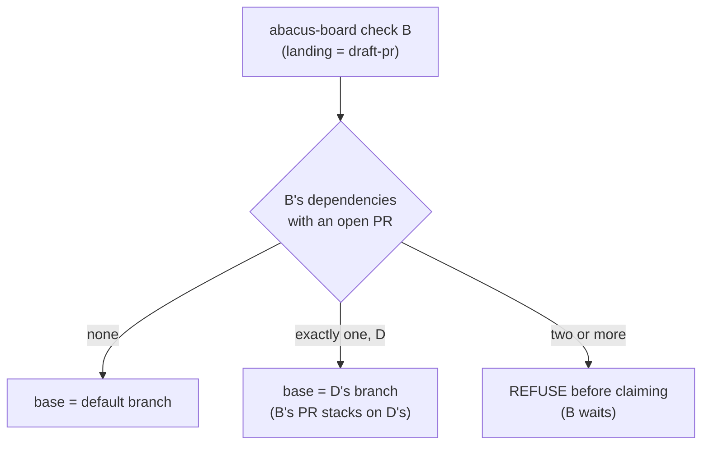
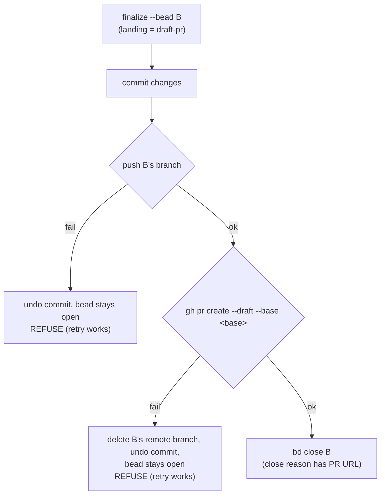

# Draft-PR landing

With `"landing": "draft-pr"` in `.abacus/config.json`, a build ends at a draft pull request instead of a push to the default branch. Use it on any repository that protects its default branch and takes changes through review. The default, `"landing": "push"`, pushes each bead straight to the default branch, which suits the demos and sandboxes. Any other value is a config error, so a typo can't quietly fall back to pushing.

In draft-pr mode a bead closes when its draft PR opens. That is where a worker's job ends, and it is what the protocol counts as done for a build in this mode (`abacus-agents/protocol/PROTOCOL.md`, "What the operator's verbs mean"). Merging stays with people.

## Branches

Each bead lands on its own branch, `abacus/<slug>-<bead-id>`, for example `abacus/add-sidebar-sign-out-baud-26f`. The slug is the bead title in lowercase, with each run of other characters turned into a single hyphen, cut to 40 characters. It makes the branch readable in GitHub's branch list. The bead id at the end keeps the name unique and lets Abacus find a bead's branch on the remote without storing it anywhere. The `abacus/` prefix keeps machine branches apart from people's.

## Choosing the base

`abacus-board check` picks the base before it claims the bead, syncs the run to it, and records it in the run's `start.json`, so the probe and finalize work from the same base. The choice depends on the bead's dependencies:

- If none has an open PR, the base is the default branch. A dependency whose PR has merged is already there.
- If exactly one has an open PR, the base is that dependency's branch, and the bead's PR stacks on it. The PR then shows only its own change, and when the parent merges and its branch is deleted, GitHub retargets the PR to the branch the parent merged into.
- If two or more have open PRs, check refuses before claiming and names them. A branch has one parent, and a merge of both would be a change no one could review as one PR. The bead becomes runnable once all but one have merged.

## Finalize

`abacus-finalize` is the only step that commits, pushes and closes. In draft-pr mode it runs:

Finalize commits with the usual trailers and pushes the bead's branch. The pre-push hook runs the repository gate under the heavy lock, as it does for any push. Finalize then opens the PR with `gh pr create --draft --base <base>` and closes the bead, adding the PR URL to the close reason's per-criterion evidence.

A failure before the close leaves the bead open, and running finalize again starts clean:

- If the push fails, finalize undoes its commit and leaves the changes staged.
- If `gh pr create` fails, finalize deletes the bead's remote branch and undoes the commit, so no branch is left on the remote without a PR. The delete uses `--no-verify` because a deletion gives the gate nothing to check. The retry runs the gate again.

## The pull request

The title is the bead title. Finalize writes the body from what it already holds:

- the worker's summary (`--summary`)
- each acceptance criterion with its verdict and evidence from the verdict file
- `Closes #N` when the bead's external ref is a GitHub issue
- for a stacked PR, the PR it builds on

The body carries no bead ids. Boards are local to each clone, so anyone reading the PR couldn't look them up.

## Probe and verify

The per-stage probe watches the tip of the run's base branch. A parent branch that moves mid-run ends the run, while unrelated pushes to the default branch leave a stacked run alone.

`abacus-verify` checks that the bead's commit is the head of its PR, since the commit only reaches the default branch when someone merges it. The orchestrator's `verify-report` shows that check to the operator.

## Records

A closing run's retro is committed with the change, so it rides in the bead's PR.

An escalation retro (`abacus-finalize --record`) gets its own draft PR, from `abacus/<slug>-<bead-id>-record` against the default branch. The bead's work was reverted on escalation, so there is no PR for the retro to join, and the protected default branch refuses a direct push. Shared memory harvests a record once it is reachable from the default branch, so the retro is learned from when its PR merges.
