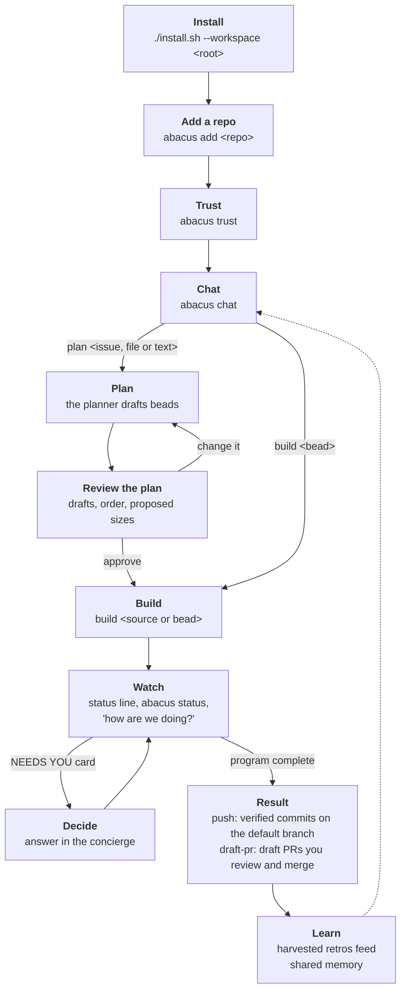
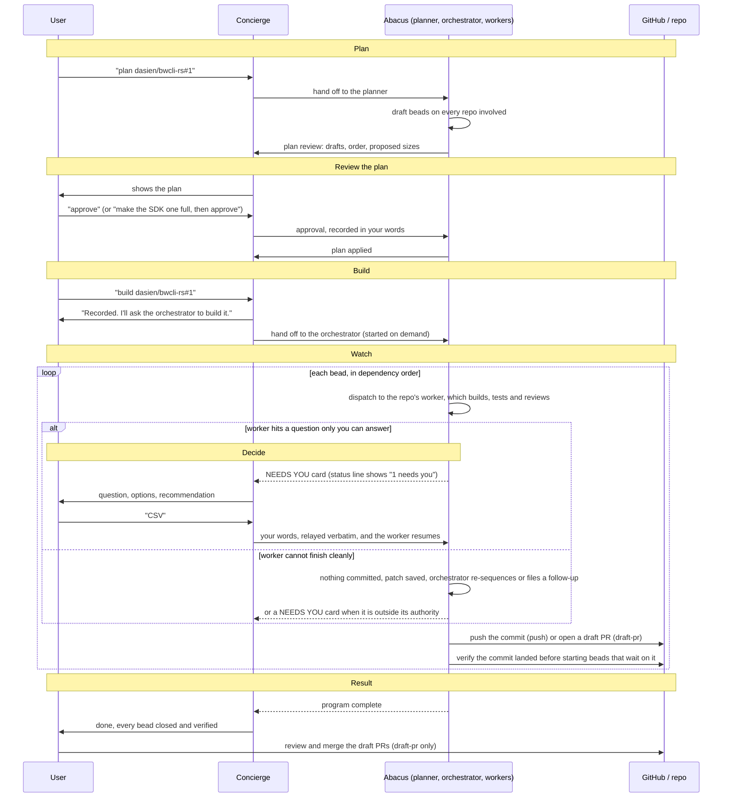

# Abacus end to end

You install once and add each repository, then do everything else by talking to the concierge. The diagrams show the path from your side, and each step has its own section below.

## Overview

The whole path, from install to results and back to the concierge for the next request.

## A typical "plan, then build" request

What passes between you, the concierge, the rest of Abacus and the repository, including where you are asked to decide.

## Steps

### Install

Run `./install.sh --workspace <root>` once, with the four repositories cloned side by side. See [Getting started, step 2](GETTING-STARTED.md#2-install-3-min).

### Add a repo

Run `abacus add <repo>` and confirm what it proposes. See [Getting started, step 3](GETTING-STARTED.md#3-bring-your-own-repository-in-optional-now-3-min), and [Draft-PR landing](DRAFT-PR-LANDING.md) for the `landing` setting.

### Trust

Run `abacus trust` and accept Claude Code's trust prompt in each folder it opens. See [Getting started, step 4](GETTING-STARTED.md#4-create-the-demo-and-trust-its-folders-3-min).

### Chat

Run `abacus chat` and say what you want in plain language. See [Getting started, step 5](GETTING-STARTED.md#5-ask-abacus-to-do-the-work-5-min).

### Plan

Say "plan" with a GitHub issue, a local file or pasted text. See [How you talk to it](CONCEPTS.md#how-you-talk-to-it).

### Review the plan

Approve the drafts, their order and proposed sizes, or say what to change. See [Authority boundary](CONCEPTS.md#authority-boundary-starting-position).

### Build

Say "build" with the source or a bead, and Abacus runs it and everything it depends on, in order. See [How you talk to it](CONCEPTS.md#how-you-talk-to-it).

### Watch

Use the status line, `abacus status`, or ask the concierge "how are we doing?". See [Where to look afterwards](GETTING-STARTED.md#where-to-look-afterwards).

### Decide

Answer a NEEDS YOU card in the concierge, and your words reach the worker verbatim. See [How you talk to it](CONCEPTS.md#how-you-talk-to-it).

### Result

With `push`, each bead's commit is on the default branch; with `draft-pr`, each bead ends at a draft PR you review and merge. See [Draft-PR landing](DRAFT-PR-LANDING.md).

### Learn

Run `abacus-memory harvest-me` in a repo to add its retros and closed beads to shared memory. See [The pieces](CONCEPTS.md#the-pieces).
